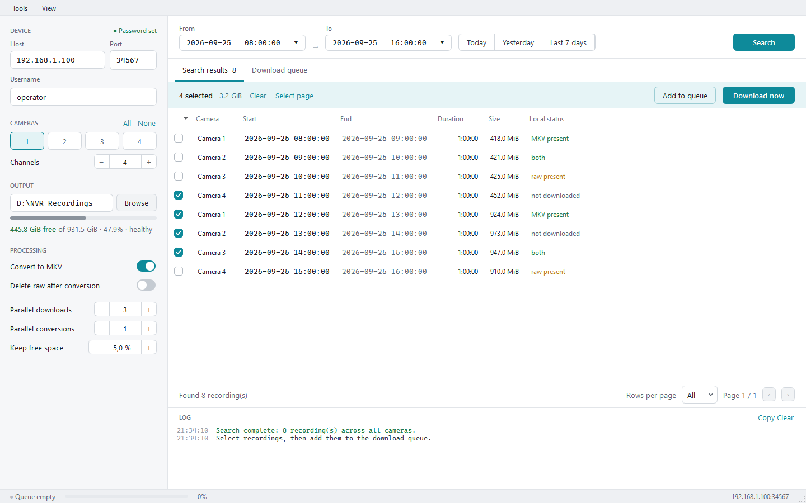
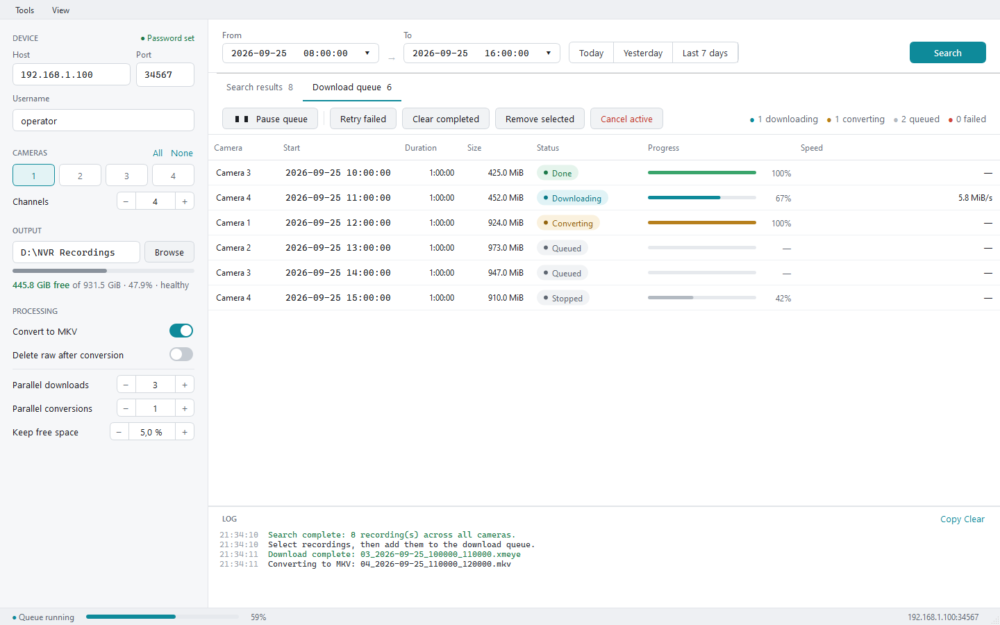

# Ръководство за графичния интерфейс

[English](GUI_GUIDE.md) | Български

Програмата позволява да търсите архиви на XMEye NVR/DVR устройства, да сваляте
записи, да поправяте повредени потоци и да ги преобразувате в проверени MP4
файлове. Интерфейсът засега е на английски; имената на командите по-долу
съответстват на надписите в програмата.

Инструкциите и снимките са проверени под Windows. Работата под Linux не е
проверена. Продължителните операции по търсене, сваляне, ремонт и конвертиране
се изпълняват извън нишката на интерфейса.

> Снимките използват примерни адреси, имена, записи и папки. Не съдържат реални
> данни за достъп или записи.

## Инсталиране и стартиране

### Portable пакет за Windows

Поддържат се Windows 10 (1809 или по-нов) и Windows 11, 64-bit.

1. Разархивирайте целия ZIP в папка, в която имате право да записвате.
2. Стартирайте **XMEyeNVR.exe** от папката **XMEyeNVR**.
3. Оставете **XMEyeConvert.exe**, **bin** и **_internal** до основния файл.

Включени са Python, Qt, FFmpeg и ffprobe. Не са необходими отделни инсталации
или промени в PATH. Не премествайте само `.exe` файла. Настройките се запазват
в Windows профила на потребителя; паролата остава само за текущата сесия.

### Стартиране от изходния код

Необходими са:

- Python 3.10 или по-нов;
- FFmpeg и ffprobe, достъпни през PATH;
- пакетите от `requirements.txt`.

Най-лесният начин за инсталиране на FFmpeg под Windows е с WinGet:

```powershell
winget install --id Gyan.FFmpeg.Essentials --exact
```

Ако WinGet не е наличен, посетете [страницата за изтегляне на FFmpeg](https://ffmpeg.org/download.html),
изберете доставчик от **Windows EXE Files** и разархивирайте Windows пакета.
Добавете неговата папка `bin`, която съдържа `ffmpeg.exe` и `ffprobe.exe`, в
потребителския или системния PATH.

След инсталирането отворете нов PowerShell прозорец и проверете:

```powershell
ffmpeg -version
ffprobe -version
Get-Command ffmpeg
Get-Command ffprobe
```

Ако команда не се разпознава, проверете дали сте добавили самата папка `bin`,
а не нейната родителска папка. И двата изпълними файла са необходими.

От папката на проекта изпълнете:

```powershell
python -m pip install -r requirements.txt
python scripts\nvr_gui.py
```

Въведете паролата в маскираното поле **Password**. Тя се пази в паметта за
текущата сесия и не се записва в настройките. Можете също да зададете
`XMEYE_PASSWORD` преди стартирането; стойността попълва същото маскирано поле.

## Търсене на записи

1. Попълнете **Host**, **Port** (DVRIP портът) и **Username**.
2. Задайте броя канали и изберете камерите за търсене.
3. Изберете папка за свалените файлове в **Output**.
4. Задайте точни начална и крайна дата и час или използвайте **Today**,
   **Yesterday** или **Last 7 days**.
5. Натиснете **Search**. Същият бутон отменя започнатото търсене.
6. Отбележете файловете и изберете **Add to queue** или **Download now**.

**Download now** стартира опашката и отваря таба **Download queue**.
**Add to queue** само добавя избраното и оставя отворен **Search results**.



Изборът на записи се запазва при смяна на страниците. **Select page** избира
записите на текущата страница. Колоната **Local status** показва:

- `not downloaded` — няма свален файл;
- `raw present` — наличен е оригинален `.xmeye` файл;
- `MP4 present` — наличен е MP4;
- `raw + MP4` — налични са оригиналът и MP4;
- `legacy MKV present` — наличен е MKV от по-стара версия; възможни са и
  комбинации с другите файлове.

Състоянието се кешира и се обновява след файлови операции, за да няма
непрекъснати проверки на диска при изчертаване и сортиране на таблицата.

## Настройки за обработка

### Convert to MP4

След свалянето стартира конвертора, който:

- копира кодираното H.264/H.265 видео без повторно кодиране;
- копира наличния AAC звук и преобразува G.711 A-law в AAC;
- възстановява последователни времена на пакетите от FC/GOP времевите маркери;
- проверява броя пакети, времевите маркери, дължината, кодека и звука;
- публикува окончателния MP4 с атомично преименуване.

**Verify entire video** е включено по подразбиране. Допълнително декодира всеки
видеокадър и при повредено видео опитва възстановяване по GOP-ове. Това е
най-пълната проверка, но натоварва процесора. При предишни измервания на
машината за проверка тази стъпка е отнела около 68 секунди за едночасов H.264
запис и около 227 секунди за едночасов HEVC запис; това не е гаранция за
скоростта на друг компютър.

Изключете **Verify entire video** за бърз режим. Проверките на пакети, времена,
дължина, кодек и звук остават, но няма пълно декодиране за откриване на повреди
във видеокадрите. При този режим пазете оригиналния `.xmeye` файл.

Паузите на рекордера се изрязват от MP4 времевата линия. При възстановяване
повредени GOP-ове могат да бъдат пропуснати; подробностите се показват в лога.

Съществуващите `.mkv` файлове се запазват и се показват като стари файлове.
Те не се броят за завършено конвертиране в MP4. Ако е запазен `.xmeye`, той
може да се конвертира без ново сваляне. Ако е останал само MKV, първо трябва
отново да се свали оригиналният запис.

При разпозната структурна повреда backend-ът създава временно почистено копие
и опитва конвертирането още веднъж. Този ремонт не презаписва оригинала.

### Delete raw after conversion

Изтрива `.xmeye` само след успешно конвертиране и проверка. Ако е бил необходим
автоматичен ремонт, оригиналът винаги се запазва, дори отметката да е включена.

Оставете настройката изключена, ако оригиналът може да е необходим за анализ
или друго конвертиране. Включете я, ако желаният краен резултат е провереният MP4.

### Паралелна работа и свободно място

- **Parallel downloads** — брой едновременни DVRIP сваляния.
- **Parallel conversions** — брой едновременни конвертирания; по подразбиране
  е едно, защото пълната HEVC проверка може да натоварва процесора.
- **Keep free space** — поставя опашката на пауза преди ново сваляне, ако
  свободното място е под зададения процент.

Всеки добавен запис запомня настройките за връзка с NVR, папката, конвертирането,
пълната проверка, изтриването и свободното място. Промени в страничния панел
по-късно не пренасочват вече добавените задачи.

## Опашка за сваляне



Опашката показва състоянието, напредъка и текущата скорост за всеки запис.

- **Start queue / Pause queue** — разрешава или спира пускането на нови
  сваляния и конвертирания. Активните операции довършват; чакащите конвертирания
  остават на пауза до следващото стартиране.
- **Cancel active** — прекъсва активните мрежови операции и процесите на
  конвертора. Опашката остава разрешена и може да започне следваща задача.
  За незабавно спиране на всичко използвайте **Pause queue**, после **Cancel active**.
- **Retry failed** — връща неуспешни, спрени или отменени записи в `Queued`.
- **Clear completed** — премахва завършените редове, без да изтрива файловете им.
- **Remove selected** — премахва избрани неактивни редове от опашката.

Десният клик върху ред предлага:

- **Open video** — отваря MP4, а при липса на MP4 — стария MKV, в избрания
  видеоплеър на Windows. Достъпно е само при налично локално видео.
- **Show in folder** — отваря местоположението и маркира файла в Windows
  Explorer. Работи и с оригинален или незавършен запис. Ако още няма файл,
  отваря съществуващата изходна папка.
- **Download again** — заявява ново сваляне на записа.
- **Stop** — спира чакащ, свалящ се или конвертиращ се запис. Ръчно спреният
  запис остава спрян при следващо пускане на опашката.
- **Delete local file** — изрично изтрива локалните `.xmeye`, MP4 и/или стари MKV
  файлове след потвърждение с точните им пътища.
- **Remove from queue** — премахва неактивен запис от опашката.

Затварянето на прозореца спира пускането на нови задачи, прекъсва активните
сваляния и конвертирания и изчаква работните нишки и процеси да приключат.

## Файлове и прекъснати сваляния

Свалянето първо записва във `filename.xmeye.part`. Едва след получен коректен
краен маркер от NVR и успешно завършване на почистващия код backend-ът
преименува файла на `filename.xmeye` с `os.replace()`.

Следователно:

- окончателният `.xmeye` се приема за завършено сваляне;
- `.part` е незавършен и не се използва като готов запис;
- съществуващ `.xmeye` може да се конвертира без ново сваляне;
- **Download again** е подходящо, ако копиран от друго място оригинал е съмнителен;
- за отчитане на завършените сваляния не се създават `.complete` файлове,
  manifest, скрита папка с метаданни или записи в регистъра. Това не се отнася
  за обичайните настройки на интерфейса в потребителския профил.

Стойността `FileLength` от някои XMEye firmware версии не е достатъчно надеждна,
за да установява завършването. Използва се за напредъка, а границата на
завършване е успешното преименуване от `.part` в `.xmeye`.

При сваляне почистващият код може да премахне невалидно запълване или данни
между валидни XMEye записи с декларирана дължина. Запазеният `.xmeye` е този
почистен поток, а не непременно точно копие на всички получени мрежови байтове.

## Ръчен ремонт

**Tools → Repair .xmeye...** създава отделно почистено копие на запис. Ремонтът
никога не презаписва входа. Проверява декларираните дължини на кадрите, търси
потвърдени граници на записи и при необходимост премахва незавършен край.

Използвайте го за записи, получени извън GUI, или за ръчен анализ. Обичайното
конвертиране вече прави един автоматичен опит за временен ремонт при
разпозната структурна повреда.

## Отстраняване на проблеми

### Показва се Password required

Въведете паролата в страничния панел или задайте `XMEYE_PASSWORD` преди
стартиране. Паролата умишлено не се пази след излизане.

### Свалянето изглежда блокирало

Архивното възпроизвеждане на много XMEye устройства предава данни на тласъци.
Паузи от десетки секунди могат да са нормални. Проверете лога и скоростта,
преди да решите, че операцията е блокирала. **Cancel active** затваря активната
DVRIP връзка, вместо само да поставя флаг за спиране.

### Конвертирането е неуспешно

Оригиналът се запазва. Проверете лога за структурна повреда, неподдържан звук,
грешка при декодиране или липсващи FFmpeg инструменти. Можете да повторите
задачата или да използвате ръчния ремонт, като запазите източника.

### Частичен запис започва преди първия си ключов кадър

Някои NVR фрагменти започват с P-кадри, които не могат да се декодират без
по-ранен I-кадър. Конверторът пропуска само тези начални недекодируеми кадри
и звука преди първия ключов кадър, след което проверява останалия запис.
Оригиналният `.xmeye` не се променя.

### VLC спираше или прескачаше към края на конвертирани файлове

По-старите версии създаваха Matroska (`.mkv`). При многократно относително
превъртане VLC можеше да достигне края на диапазона за превъртане преди края
на декодираните кадри. Текущите версии записват MP4; видеото продължава да се
копира без загуба на качество, а G.711 A-law се преобразува в AAC за съвместимост.
